# Nabodaya Sahu

**Aspiring Software Engineer · AI/ML & Full-Stack Developer**

*Building AI-powered products and full-stack applications that solve real-world problems.*

## Projects

| Project | Description | Repository |
|---|---|---|
| **ShopPilot — Agentic Commerce Assistant** | AI-focused commerce assistant concept: “Tell us what you need. Let AI do the shopping.” | [GitHub repository](https://github.com/nabodaya123/ShopPilot) |

## Connect

- [LinkedIn](https://linkedin.com/in/nabodaya-sahu-904a41340)
- [Instagram](https://www.instagram.com/nabodaya_06?obrf=NW1mb3Rrb215amdu)
- [X / Twitter](https://x.com/NabodayaS2006)
- GitHub: [@nabodaya123](https://github.com/nabodaya123)

---

Design: deep navy, electric blue, crimson and off-white. SVG illustrations embed their images and fonts; no remote assets are requested. Animation uses CSS and SMIL, with reduced-motion support. The supplied PNGs are included unchanged in `assets/` for reference.
